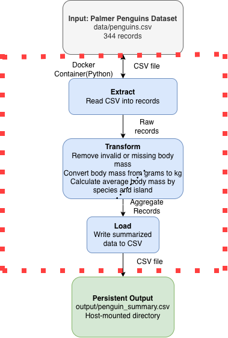

# Palmer Penguins ETL Pipeline

Data Project 1 | Fall 2026
Author: Anirudh Manikandan

## Project Purpose

This project implements a containerized Extract, Transform, and Load
(ETL) pipeline using the Palmer Penguins dataset. The pipeline
cleans penguin body mass measurements and calculates the average
body mass in kilograms by species and island.

## Data Source

The Palmer Penguins dataset contains 344 observations of penguins
from three species collected in the Palmer Archipelago, Antarctica.

Source: https://github.com/allisonhorst/palmerpenguins

Dataset documentation: https://allisonhorst.github.io/palmerpenguins/

A fixed copy of the dataset is included in data/penguins.csv.
The dataset is made available under the CC0 license.

## Architecture Diagram



## Pipeline Stages

### Extract

Read the supplied CSV dataset into Python records.

### Transform

- Reject records with missing or invalid body mass values.
- Convert body mass from grams to kilograms.
- Group penguins by species and island.
- Calculate penguin counts and average body mass for each group.

### Load

Write the summarized records to output/penguin_summary.csv.
The output directory is mounted from the host so the results
persist after the Docker container exits.

## Requirements and Configuration

- Docker installed and running.
- No API keys, credentials, or environment variables required.
- No Python installation or application dependencies required
  on the host machine.

## Build the Docker Image

Run from the repository root:

```bash
docker build -t penguin-etl:1.0 .
```

## Run the Pipeline

```bash
docker run --rm \
  -v "$PWD/data:/app/data:ro" \
  -v "$PWD/output:/app/output" \
  penguin-etl:1.0
```

## Run Automated Tests

```bash
docker run --rm penguin-etl:1.0 python -m pytest tests/ -v
```

The five automated tests verify:

1. Extraction of expected records and fields.
2. Correct transformations and calculations.
3. Handling of invalid and missing data.
4. Correct loading of CSV output.
5. Complete end-to-end pipeline execution.

## Expected Output

The output is saved to output/penguin_summary.csv.

| Species | Island | Penguin Count | Average Body Mass (kg) |
|---|---|---:|---:|
| Adelie | Biscoe | 44 | 3.710 |
| Adelie | Dream | 56 | 3.688 |
| Adelie | Torgersen | 51 | 3.706 |
| Chinstrap | Dream | 68 | 3.733 |
| Gentoo | Biscoe | 123 | 5.076 |

## Run Metrics

The pipeline reports useful execution metrics:

- Records read: 344
- Records rejected: 2
- Records processed: 342
- Records written: 5
- Elapsed execution time in seconds

Execution time varies by machine.

## Credits

- Dataset: Allison Horst, Alison Hill, and Kristen Gorman,
  Palmer Penguins.
- Original data collected by Dr. Kristen Gorman and
  Palmer Station Long Term Ecological Research.
- Python standard library: csv, pathlib, collections, and time.
- Automated testing: pytest.
- Containerization: Docker.
- OpenAI ChatGPT assisted with code development, testing,
  and documentation.

## License

Project source code is licensed under the MIT License.
See LICENSE for details.

## Published Docker Image (Extra Credit)

The versioned Docker image is publicly available through
GitHub Container Registry.

Run the pipeline without building the image locally:

```bash
docker run --rm --pull always \
  -v "$PWD/output:/app/output" \
  ghcr.io/anirudh110707/penguin-etl:1.0
```

The sample dataset is included in the published image.
The output persists in the host-mounted output directory.
No registry authentication is required.
